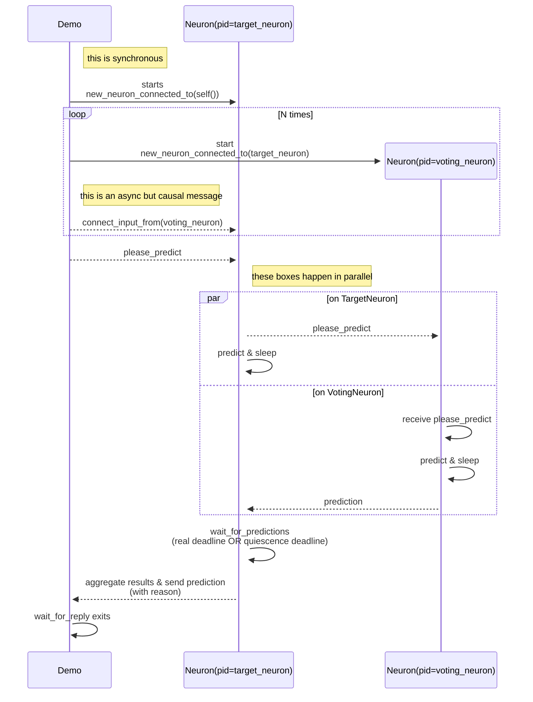

# elixir_ne

- **Run:** `scripts/run.sh` — one node. **N nodes:** `NODE_COUNT=N scripts/run.sh` — workers start in the background, node1 connects to them and runs the demo.
- **Interactive:** `scripts/start-interactive.sh`, or `NODE_COUNT=2 scripts/start-interactive.sh` for one IEx (node1) plus a worker (node2). Workers are killed when the script exits. Then `Node.connect(:"node2@127.0.0.1"); Demo.start([])`.
- **Vote in Python instead of in Elixir processes:** `USE_PYTHONX=1 scripts/run.sh` — see [voting in Python](#voting-in-python-pythonx).
- **Overrides:** `N_NEURONS`, `NEURON_SLEEP_FOR_MS`, `PREDICTION_DEADLINE_MS`, `DEMO_REPLY_TIMEOUT_MS`, `NODE_COUNT` in the environment, or options passed to `Demo.start(...)` in IEx; arguments win over the environment.

## structure



- Demo structure: [lib/demo.ex](lib/demo.ex)
  - requires [Elixir](https://elixir-lang.org/install.html) being installed
  - a single "demo" neuron is instantiated
  - a `n==1000` neurons are started, knowing their target neuron
  - these are connected to the "demo" neuron
  - a prediction is requested (artificially), by sending the "demo" neuron a message
  - this in turn requests predictions from its connections
- Simulated voting neuron: [lib/neuron.ex](lib/neuron.ex)
  - if there are no connections, the neuron just returns a random number and sleeps a bit (`delay`)
  - if there are connections, the neuron tries to receive all the predictions, but within a real deadline (`prediction_deadline_ms`)
  - in addition, it stops early on inactivity after `prediction_quiescence_deadline_ms` (defaults to `200`)
  - returns the maximal value received so far or `-1` if none were received before stopping
  - *TODO*: return the best prediction if it's above a numeric threshold
- written deliberately without [GenServer](https://hexdocs.pm/elixir/GenServer.html)s to demonstrate actual message passing that could be mapped onto neuron signalling
  - the Pythonx batch voter is the one exception: it is plumbing around an interpreter, not a neuron
- see the build [output](https://github.com/d-led/elixir_ne/actions)
- startup observability: per node, how many neurons were started, how long spawning took, and the resident memory of that node's OS process at that moment (`node_rss_mb`)
- the prediction output reports `python_interpreters` when the run voted in Python

## paste your latest run outputs here

- single-node run output:

```shell
# paste terminal output from single-node run here
```

- distributed run output:

```shell
# paste terminal output from distributed run here
```

## voting in Python (Pythonx)

The same vote can be computed by CPython instead of by one Elixir process per
neuron. Comparing these two ways of voting is the point of the Pythonx mode, not
speed:

```shell
USE_PYTHONX=1 scripts/run.sh                    # one CPython per node
NODE_COUNT=2 USE_PYTHONX=1 scripts/run.sh       # one CPython per node, two voters in total
```

- [lib/batch_voter.ex](lib/batch_voter.ex) stands in for a whole batch of neurons: the single `BatchVoter` of a node asks CPython for one vote per neuron it replaces and answers with one `{:prediction_batch, votes}` message, which the collecting neuron counts as that many votes
- Pythonx embeds the interpreter into the BEAM's own OS process ([why](https://github.com/elixir-pythonx/pythonx)), and the GIL serializes Python code, so one interpreter and one vote process per node is all there is
- the vote distribution is the same as a neuron's (`abs(gauss(50, 20))`), but the Pythonx path skips the simulated compute delay (`NEURON_SLEEP_FOR_MS`): it compares the cost of voting, not end-to-end latency
- Pythonx is started on the first vote, so a run that does not use it never loads an interpreter

### measuring it

`:erlang.memory/1` only counts what the BEAM allocated; an embedded CPython keeps
its heap outside of that. Memory is therefore read from the OS as the resident
memory of the node's process ([lib/node_memory.ex](lib/node_memory.ex)).

- `mix run -e 'Demo.measure_pythonx_ram()'` — what the interpreter costs, measured across its first eval on this node
- `Demo.benchmark_ram(number_of_neurons: 10_000, use_pythonx: false)` (or `use_pythonx: true`) — resident memory a run adds on this node, with the growth per neuron extrapolated to a gigabyte. The benchmark leaves its neurons running until they time out, so run it in a fresh node and not before a real run.
- every Pythonx run prints a run summary after the prediction (interpreter count and per-node residency, with the interpreter live)

## back-pressure notes

- for large distributed runs, BEAM distribution back-pressure is expected; it slows senders when node-to-node buffers are busy, instead of silently dropping messages
- in this demo, the top-level neuron is a fan-in bottleneck (many senders, one receiver), so back-pressure and mailbox growth can dominate runtime before all predictions are consumed
- practical mitigations:
  - keep `ELIXIR_ERL_OPTIONS="+P 5000000"` (or higher if needed) so process limits are not the first bottleneck
  - reduce `number_of_neurons` for interactive experiments and increase gradually
  - increase `prediction_deadline_ms` when you want to use more late arrivals in aggregation
  - increase `demo_reply_timeout_ms` when the top-level demo wait expires before a reply is printed
  - prefer running the load from one initiating node at a time; avoid overlapping large runs in multiple consoles
- if you need to inspect runtime limits, these are useful checks:

```shell
erl -noshell -eval 'io:format("process_limit=~p~n", [erlang:system_info(process_limit)]), io:format("dist_buf_busy_limit=~p~n", [erlang:system_info(dist_buf_busy_limit)]), halt().'
```

- distribution back-pressure is parameterizable; if you need to tune it for experiments, set dist buffer busy limit with `+zdbbl` (for example `export ELIXIR_ERL_OPTIONS="+P 5000000 +zdbbl 2048"`)

- change the code if necessary and hot-code reload in the cluster before running again:
  `r [Demo, Neuron]; nl Demo; nl Neuron`

## ideas behind it

- brain has metabolic constraints: [Theriault et. al.: The sense of should: A biologically-based model of social pressure 10.31234/osf.io/x5rbs](https://psyarxiv.com/x5rbs/)
- neurons have thousands of synapses: [Hawkins & Ahmad: Why Neurons Have Thousands of Synapses, a Theory of Sequence Memory in Neocortex doi:10.3389/fncir.2016.00023](https://www.frontiersin.org/articles/10.3389/fncir.2016.00023/full)
- neurons might be voting on predictions [Hawkins et. al.: A Framework for Intelligence and Cortical Function Based on Grid Cells in the Neocortex doi:10.3389/FNCIR.2018.00121](https://numenta.com/neuroscience-research/research-publications/papers/thousand-brains-theory-of-intelligence-companion-paper/)
- neurons are physically parallel
- each neuron (or an aggregation of neurons for efficiency reason) can be represented by an [Erlang process](https://en.wikipedia.org/wiki/Erlang_(programming_language)#Erlang_Worldview)
- in a rythmic fashion, attention seems to be interrupted: [A rhythmic theory of attention by Ian C. Fiebelkorn, Sabine Kastner](https://pmc.ncbi.nlm.nih.gov/articles/PMC6343831/#S1): "We propose that the presently attended location is periodically re-assessed (**every ~250 ms**) to confirm that it is still the most important location", "These periodic disruptions in attention-related sampling may have provided our ancestors with an evolutionary advantage, e.g., allowing them to detect and therefore avoid predators while foraging."

## disclaimer

- I'm not a professional researcher
- this is a spare time project to play around with ideas
